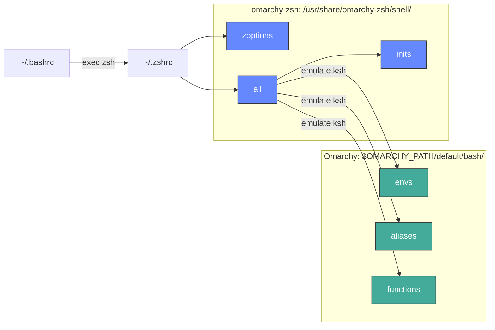

Omarchy shell configuration for Zsh shell.

## Architecture

The shared shell config (envs, aliases, functions) is not copied into this package. `shell/all` sources it live from the installed Omarchy at `$OMARCHY_PATH/default/bash/`, so zsh picks up Omarchy's changes as soon as Omarchy itself updates, with no rebuild of this package. This repo only contains the zsh-specific bits: options, keybindings, completion, and tool init.



Green = shared, read live from Omarchy. Blue = zsh-specific (from this repo).

Omarchy's files are written for bash, so `shell/all` sources them with `emulate ksh -c`. zsh records that emulation on every function they define and restores it whenever the function runs, which keeps bash semantics such as 0-indexed arrays inside those functions while the rest of the shell stays native zsh. Aliases defined before `shell/all` runs (for example by oh-my-zsh) are set aside while Omarchy's files load, so an alias like `ga='git add'` can't corrupt the parsing of Omarchy's `ga()` function, and are restored afterwards unless Omarchy defines the same name.

## Install

```bash
# Install the package
sudo pacman -S omarchy-zsh

# Setup zsh (optional: auto-launch from bash)
omarchy-setup-zsh
```

## fzf Keybindings

- **Ctrl+Alt+F** - Search files/directories
- **Ctrl+Alt+L** - Search Git Log
- **Ctrl+R** - Search command history
- **Ctrl+T** - Search files in current directory
- **Ctrl+Alt+V** - Search Variables
- **Alt+C** - cd into selected directory

## Customization

To add your own configuration or override defaults:

```bash
# Edit your .zshrc
nvim ~/.zshrc

# Add customizations at the bottom after the omarchy-zsh loading
```

User customizations in `~/.zshrc` take precedence over system defaults.

## Uninstall

```bash
sudo pacman -R omarchy-zsh
```

To restore bash, copy a backup to `~/.bashrc` (backups are saved as `.bashrc.backup-*`).
